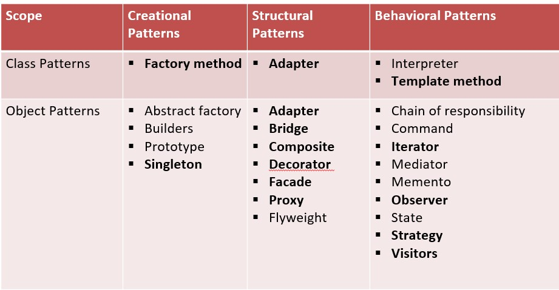
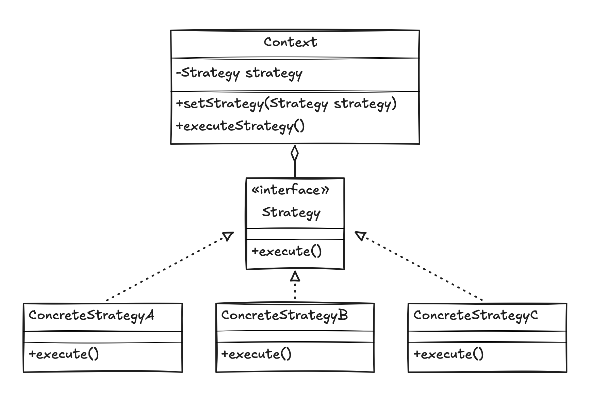
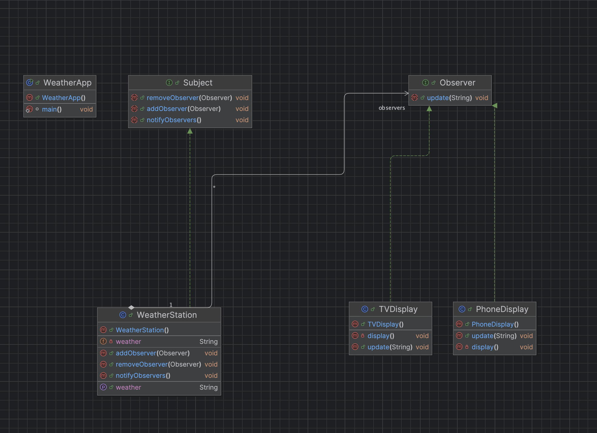

# Design Patterns

Un **Design pattern** décrit à la fois :
- **Un problème** qui se produit très fréquemment, dans un environnement,
- **Et l’architecture de la solution** à ce problème de telle façon que l’on puisse utiliser cette solution des milliers de fois.

Il permet de décrire avec succès des types de solutions récurrentes à des problèmes communs dans des types de situations.

### Les design patterns offrent :
- **Une documentation d’une expérience éprouvée** de conception.
- **Une identification et spécification d'abstractions** qui sont au-dessus du niveau des simples classes et instances.
- **Un vocabulaire commun** et une aide à la compréhension de principes de conception.
- **Un moyen de documentation** de logiciels.
- **Une aide à la construction de logiciels complexes et hétérogènes**, répondant à des propriétés précises.

<p align="center">
  
</p>

## Objectifs du projet

- Comprendre les concepts de conception réutilisables
- Mettre en pratique les design patterns en Java
- Structurer un code plus lisible, maintenable et évolutif
- Servir de base pour des démonstrations et des travaux académiques

## Prérequis

- Java JDK 25 ou supérieur
- Un terminal ou un IDE Java (IntelliJ IDEA, Eclipse, VS Code)

## Structure du projet

```text
designpattern/
├── src/
│   ├── comportement/
│   │   ├── observerpattern/
│   │   │   ├── Observer.java
│   │   │   ├── PhoneDisplay.java
│   │   │   ├── Subject.java
│   │   │   ├── TVDisplay.java
│   │   │   ├── WeatherApp.java
│   │   │   └── WeatherStation.java
│   │   └── strategypattern/
│   │       ├── isortImpl/
│   │       │   ├── BubbleSort.java
│   │       │   ├── InsertionSort.java
│   │       │   └── SelectionSort.java
│   │       ├── Client.java
│   │       ├── Context.java
│   │       └── ISort.java
│   ├── creation/
│   └── structure/
├── screens/
│   ├── gof.png
│   ├── observer.png
│   └── strategy.png
├── README.md
├── .gitignore
├── designpattern.iml
└── out/
```

## Catégories de design patterns

Les design patterns sont organisés selon trois grandes familles :

### 1. Création
- **Description** : Description de la manière dont un objet ou un ensemble d’objets peuvent être créés, initialisés, et configurés.
- **Isolation** : Isolation du code relatif à la création et à l’initialisation afin de rendre l’application indépendante de ces aspects.
- **Exemples** : Abstract Factory, Builder, Prototype, Singleton.

### 2. Structure
- **Description** : Description de la manière dont doivent être connectés des objets de l’application afin de rendre ces connexions indépendantes des évolutions futures de l’application.
- **Exemples** : Adapter (objet), Composite, Bridge, Decorator, Facade, Proxy.

### 3. Comportement
- **Description** : Description de comportements d’interaction entre objets et gestion des interactions dynamiques entre des classes et des objets.
- **Exemples** : Strategy, Observer, Iterator, Mediator, Visitor, State.

---

## Design Pattern : Strategy (Stratégie)

- **Catégorie** : Comportement

<p align="center">
  
</p>

### Objectifs
- Définir une famille d’algorithmes, et encapsuler chacun et les rendre interchangeables tout en assurant que chaque algorithme puisse évoluer indépendamment des clients qui l’utilisent.

### Raison d’utilisation
- Un objet doit pouvoir faire varier une partie de son algorithme dynamiquement.

### Résultat
- Le Design Pattern permet d'isoler les algorithmes appartenant à une même famille d'algorithmes.

### Fonctionnement et structure
- **Interface de stratégie** : On crée une interface de base, appelée ici « Strategy » (ou `ISort` dans notre implémentation), et on y ajoute une méthode qui sera la méthode qui applique notre stratégie.
- **Classes concrètes** : Il suffit alors de créer des classes concrètes qui implémentent cette interface « StrategyImpl » (`BubbleSort`, `SelectionSort`, `InsertionSort`) et qui redéfinissent la méthode de stratégie.
- **Contexte** : À un instant donné, la classe « Context » qui va utiliser la stratégie compose une instance de l’une des implémentations de Strategy. Elle peut ainsi modifier ou basculer dynamiquement d'algorithme au cours de l'exécution.

### Exemple implémenté dans le projet
Le code source correspondant à ce pattern est disponible dans :
- Interface de stratégie : [`ISort.java`](src/comportement/strategypattern/ISort.java)
- Implémentations d'algorithmes de tri : [`BubbleSort.java`](src/comportement/strategypattern/isortImpl/BubbleSort.java), [`SelectionSort.java`](src/comportement/strategypattern/isortImpl/SelectionSort.java), [`InsertionSort.java`](src/comportement/strategypattern/isortImpl/InsertionSort.java)
- Contexte : [`Context.java`](src/comportement/strategypattern/Context.java)
- Point d'entrée de test : [`Client.java`](src/comportement/strategypattern/Client.java)

---

## Design Pattern : Observer (Observateur)

- **Catégorie** : Comportement

<p align="center">
  
</p>

### Problème résolu
Dans une application, lorsqu'un objet (le **Sujet** / **Observable**) change d'état, plusieurs autres objets (**Observateurs**) doivent en être informés et réagir. 
- **Sans le pattern** : Le sujet devrait instancier ou connaître toutes les classes concrètes qui l'écoutent (couplage fort, violation d'OCP) ou les observateurs devraient scruter le sujet en boucle (*polling*, gaspillage de CPU).
- **Avec l'Observer** : On définit une dépendance **1-à-N** (One-to-Many) à **couplage faible**. Le sujet n'interagit qu'avec l'interface abstraite `Observer`, sans connaître l'identité ni le nombre d'abonnés. Dès qu'un changement a lieu, ils sont notifiés automatiquement.

### Fonctionnement et rôles
- **`Subject` (Interface)** : Définit les opérations pour enregistrer (`addObserver`), supprimer (`removeObserver`) et notifier (`notifyObservers`) les observateurs.
- **`WeatherStation` (Sujet concret)** : Implémente `Subject`, maintient la liste des observateurs et stocke l'état météo (`weather`). À chaque modification via `setWeather(...)`, il diffuse automatiquement la nouvelle météo à tous les observateurs abonnés.
- **`Observer` (Interface)** : Interface fonctionnelle (`@FunctionalInterface`) définissant la méthode de mise à jour (`update(String weather)`).
- **`PhoneDisplay` & `TVDisplay` (Observateurs concrets)** : Implémentent `Observer` pour afficher les alertes météo sur différents supports avec leur propre mise en page (`display()`).
- **`WeatherApp` (Client / Démonstration)** : Configure la station météo, abonne les afficheurs, simule plusieurs changements d'état (`Sunny`, `Rainy`, `Cloudy`), désabonne `TVDisplay`, puis effectue une nouvelle mise à jour (`Windy`).

### Exemple implémenté dans le projet
Le code source est disponible dans :
- Interfaces : [`Subject.java`](src/comportement/observerpattern/Subject.java) & [`Observer.java`](src/comportement/observerpattern/Observer.java)
- Sujet concret : [`WeatherStation.java`](src/comportement/observerpattern/WeatherStation.java)
- Observateurs concrets : [`PhoneDisplay.java`](src/comportement/observerpattern/PhoneDisplay.java) & [`TVDisplay.java`](src/comportement/observerpattern/TVDisplay.java)
- Point d'entrée de test : [`WeatherApp.java`](src/comportement/observerpattern/WeatherApp.java)

---

## Auteur

Abdlatif Nabgha
